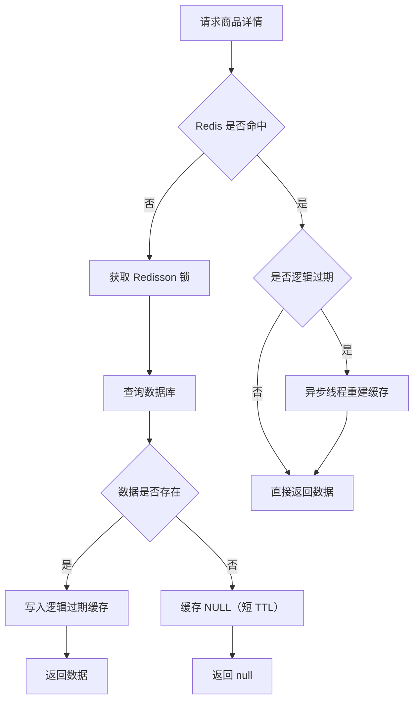

# Lucky Box 幸运盲盒商城（后端）

基于 **Spring Boot 3 + MyBatis-Plus + Redis/Redisson + RabbitMQ + MinIO** 的盲盒电商后端项目，覆盖登录认证、商品与 SKU、盲盒管理、抽奖下单、卡片与合成、图片上传等核心能力，并重点实践了 Redis 缓存的三大问题（穿透、击穿、雪崩）解决方案。

> 仓库地址：https://github.com/wyh-debug/Lucky-Box.git

---

## 技术栈

| 分类 | 技术 |
| --- | --- |
| 语言 / 运行时 | Java 21 |
| 框架 | Spring Boot 3.3.1、Spring Web、Spring AOP |
| 持久层 | MyBatis-Plus 3.5.5、MySQL 8 |
| 缓存 | Redis、Redisson（分布式锁）、Spring Data Redis |
| 消息队列 | RabbitMQ（Spring AMQP） |
| 对象存储 | MinIO 8.6 |
| 安全 | Spring Security（BCrypt 密码加密） |
| 工具库 | Hutool 5.8、Lombok |
| 构建 | Maven |

---

## 功能模块

### 1. 登录认证

- **验证码**：随机 6 位数字，存入 Redis
  - Key：`login:code:{phone}`，类型 **String**，有效期 2 分钟
  - 手机号格式校验（正则工具 `RegexUtils`）
- **Token**：登录成功后生成 UUID Token，将用户信息（`UserDTO`）存入 Redis
  - Key：`login:token:{token}`，类型 **Hash**，有效期 36000 分钟
- **两种登录方式**
  - `POST /auth/code` → `POST /auth/login`：手机号 + 验证码登录，手机号不存在时自动注册（昵称 `user_` + 随机串）
  - `POST /auth/admin/login`：管理员账号密码登录，BCrypt 校验密码
- **登录拦截**
  - `RefreshTokenInterceptor`（order=0）：读取请求头 `authorization` 中的 Token，从 Redis Hash 还原 `UserDTO` 写入 `UserHolder`，并刷新 Token 有效期
  - `LoginInterceptor`（order=1）：校验登录状态，对登录、商品详情/列表、商品分类等公开接口放行
- **权限控制**：自定义注解 `@AdminRequired` + AOP 切面 `PermissionAspect`，校验当前用户角色是否为 `ADMIN`

### 2. 商品模块

- **商品分类**
  - 增、删、改、查；写操作使用 `@AdminRequired` 做权限控制
  - 删除前校验是否存在子分类
  - 查询支持**树形结构**分级返回（先查全量，再按 `parentId` 组装 children）
- **商品管理**
  - 增 / 删 / 改（管理员），删除前先检查是否存在 **商品 SKU**
  - 关联商品缓存：新增即写缓存，修改/删除时清理缓存
- **商品详情缓存（逻辑过期）**
  - Key：`cache:product:{id}`，存储 `RedisData{expire, data}` 包装对象
  - 逻辑过期 1440 分钟，物理 TTL 36000 分钟
  - 缓存不存在：获取 Redisson 分布式锁 → 查数据库 → 回写缓存；数据库不存在则缓存 `"NULL"` 防止穿透
  - 缓存存在且已逻辑过期：返回旧数据，同时提交**异步线程**重建缓存（互斥锁防止并发重建）
  - 缓存存在且未逻辑过期：直接返回
- **分页 / 筛选 / 排序**
  - 分页查询（`Page` + 自定义 Mapper）
  - 按分类查询商品，规格参数以数组传递，使用 MySQL JSON 函数匹配：
    ```sql
    JSON_CONTAINS(p.specifications, JSON_QUOTE(#{s}), '$."${key}"')
    ```
  - 查询前对规格 / 属性 Key 做 SQL 合法性校验，防止注入
  - 按价格升序 / 价格降序 / 销量排序
- **销量**
  - 数据库设置冗余销量字段
  - 计划：Redis 中累计（下单支付 +1、退款 -1），定时统一同步数据库（*尚未实现*）

### 3. 商品 SKU

- 增加 / 修改 / 删除（管理员）
- **删除前检查四个关联表**，存在关联数据则不允许删除：
  - `synthesis_record`（合成记录）
  - `synthesis_rule`（合成规则）
  - `mystery_box_product_rel`（盲盒商品关联）
  - `product_order`（商品订单）
- **查询采用两个接口**
  - `GET /productSku/pro/{proId}`：从商品列表进入，取出商品信息（走商品缓存），拼接好规格返回，默认展示第一个 SKU
  - `GET /productSku/{id}`：点击其他规格后进入对应 SKU 详情
- SKU 变化频繁，**不写入缓存**，复用商品缓存数据

### 4. 订单管理

- 订单 ID 使用自增生成器 `OrderIdGenerate`（`nextId("order")`）
- **普通商品订单**
  - 前端选择收货地址，先做 Redis 预扣库存（`lock:product:stock:{skuId}`）
  - 通过 **RabbitMQ** 异步落库：
    - Exchange：`order.topic`（Topic）
    - RoutingKey：`order.insert`
    - Queue：`order.insert.queue`
  - 消费者 `OrderListener`：数据库原子扣减库存失败时回滚 Redis 预扣数量，随后写入 `base_order` 与 `product_order`，地址以 JSON 快照保存
- **盲盒订单**（`addBoxOrder`）
  - 校验盲盒是否存在、库存是否充足
  - 修改订单类型（`ORDER_TYPE_BOX`）
  - 生成地址快照与盲盒快照（JSON）
  - 按购买数量批量生成抽奖记录（`lucky_box_draw_record`）
- **盲盒抽奖**（`LuckyBoxDrawRecordServiceImpl.create`）
  1. 查询抽奖记录（状态为可用 `status = 0`）
  2. 查询盲盒商品规则（仅启用状态），校验概率总和必须为 **1**，否则禁用盲盒
  3. 按概率区间随机命中商品
  4. 原子扣减盲盒商品库存（库存不足扣除失败）
  5. 查询商品信息（走缓存）生成中奖商品快照
  6. 关联发货：创建商品订单，回写抽奖记录
  7. 保底商品 / 安慰奖机制（*规划中*，代码已预留位置）
- **事务增强**：需要代理调用的事务方法通过 `AopContext.currentProxy()` 调用，启动类已开启
  `@EnableAspectJAutoProxy(exposeProxy = true)`

### 5. 盲盒管理

- **盲盒分类**：增删改查，支持分页
- **盲盒**
  - 新增、修改、查询（读取 `cache:box:{id}` 缓存）
  - 删除前校验 `lucky_box_card`、`lucky_box_order`、`lucky_box_product` 关联数据
- **盲盒商品（多对多）**
  - 单个添加：校验概率不得大于 1
  - 批量添加：校验商品存在、总概率不得超过 1；总概率不足 1 时**禁用盲盒**，禁止抽奖
  - 删除：至少保留一个商品，否则彻底禁用盲盒，并生成通知提醒管理员（`notification`）
  - 修改：概率变更需重新校验总和
  - 查询：先对盲盒进行分页，再查询商品
- **通知模块**：`notification` 支持 SYSTEM / BOX / ORDER 三类通知

### 6. 卡片管理

- **卡片类型**：增删改查
- **卡片**
  - 删除前校验 `lucky_box_card`、`synthesis_rule` 关联
  - 卡片带默认概率，盲盒关联时可覆盖（`probabilityOverride`）
- **合成**：`synthesis_rule`（合成规则）+ `synthesis_record`（合成记录）

### 7. 图片上传

- 集成 **MinIO** 对象存储，`MinioController` 提供文件上传接口
- 相关配置：`spring.minio.endpoint / accessKey / secretKey / bucketName`

### 8. 缓存工具封装

`CacheClient` 统一封装缓存策略：

| 方法 | 作用 |
| --- | --- |
| `setWithLogicalExpire` | 写入带逻辑过期时间的数据（`RedisData`） |
| `handleCacheBreakDown` | 逻辑过期 + Redisson 互斥锁 + 异步重建，解决缓存击穿 |
| `cacheNullValue` | 空值缓存 + 随机 TTL，解决缓存穿透与雪崩 |

---

## 缓存设计



---

## Redis Key 设计

| Key 前缀 | 类型 | 说明 | 过期时间 |
| --- | --- | --- | --- |
| `login:code:` + phone | String | 登录验证码 | 2 分钟 |
| `login:token:` + token | Hash | 用户登录信息 `UserDTO` | 36000 分钟（拦截器每次续期） |
| `cache:product:` + id | String | 商品缓存（逻辑过期包装） | 逻辑 1440 分钟 / 物理 36000 分钟 |
| `product:lock:` + id | - | 商品缓存重建锁 | - |
| `product:sku:` | - | SKU 相关缓存前缀 | 36000 分钟 / 逻辑 1440 分钟 |
| `product:sale:` | - | 商品销量统计（规划） | - |
| `cache:box:` + id | String | 盲盒缓存 | 逻辑 1440 分钟 / 物理 36000 分钟 |
| `box:lock:` / `boxId:lock:` | - | 盲盒缓存重建 / 新增锁 | - |
| `cache:card:` + id | String | 卡片缓存 | 36000 分钟 |
| `lock:card:` + id | - | 卡片缓存重建锁 | - |
| `lock:product:stock:` + skuId | String | 商品库存预扣数量 | - |
| `lock:order:` | - | 订单相关锁 | - |

---

## 项目结构

```
src/main/java/com/luckybox
├── annotation        # 自定义注解（@AdminRequired）
├── aspect            # AOP 切面（权限校验）
├── config            # Security / MVC / MyBatis-Plus / RabbitMQ / MinIO 配置
├── constant          # Redis、MQ、系统常量
├── controller        # REST 接口层
├── hander            # MyBatis-Plus 自动填充
├── interceptor       # 登录拦截、Token 刷新
├── listener          # RabbitMQ 订单消费者
├── mapper            # MyBatis-Plus Mapper
├── pojo
│   ├── dto           # 请求/内部传输对象
│   ├── entity        # 数据库实体
│   └── vo            # 视图对象
├── service
│   ├── impl          # 业务实现
│   └── I*.java       # 业务接口
├── utils             # 缓存工具、ID 生成、正则、UserHolder
└── LuckyBoxApplication.java
```

---

## 主要接口

> 除白名单接口外，均需在请求头携带 `authorization: {token}`；`@AdminRequired` 接口要求管理员角色。

| 模块 | 接口前缀 | 说明 |
| --- | --- | --- |
| 认证 | `/auth` | 验证码、用户登录、管理员登录 |
| 商品分类 | `/productCategory` | 分页、树形列表、增删改（管理员） |
| 商品 | `/product` | 增删改（管理员）、详情、分页筛选、排序 |
| 商品 SKU | `/productSku` | 增删改（管理员）、按商品查询 SKU、按 SKU 查询详情 |
| 地址 | `/address` | 收货地址管理 |
| 订单 | `/order` | 基础订单 |
| 商品订单 | `/product-order` | 商品订单 |
| 盲盒分类 | `/box-category` | 盲盒分类管理 |
| 盲盒 | `/box` | 盲盒增删改查（带缓存） |
| 盲盒商品 | `/box-product` | 盲盒商品关联、概率管理 |
| 盲盒卡片 | `/box-card` | 盲盒卡片关联、概率管理 |
| 盲盒订单 | `/box-order` | 创建盲盒订单 |
| 抽奖记录 | `/draw-record` | 盲盒抽奖 |
| 卡片 | `/card` | 卡片增删改查 |
| 卡片类型 | `/card-type` | 卡片类型管理 |
| 合成 | `/synRecord`、`/synthesisRule` | 合成记录与合成规则 |
| 通知 | `/notification` | 系统 / 盲盒 / 订单通知 |
| 文件上传 | `/minio` | MinIO 图片上传 |

---

## 快速开始

### 环境要求

- JDK 21
- Maven 3.8+
- MySQL 8.0+
- Redis 6.0+
- RabbitMQ（启用订单异步落库时需要）
- MinIO（图片上传功能需要）

### 1. 初始化数据库

导入 `src/main/resources/lucky_box.sql`：

```bash
mysql -uroot -p lucky_box < src/main/resources/lucky_box.sql
```

### 2. 修改配置

编辑 `src/main/resources/application.yml`，按实际环境调整：

```yaml
server:
  port: 8081

spring:
  minio:
    endpoint: http://192.168.88.128:9000
    accessKey: 
    secretKey: 
    bucketName: box
  datasource:
    driver-class-name: com.mysql.cj.jdbc.Driver
    url: jdbc:mysql://192.168.88.128:3306/lucky_box?useSSL=false&serverTimezone=Asia/Shanghai
    username: 
    password:
  data:
    redis:
      host: 192.168.88.128
      port: 6379
      password: 
  rabbitmq:              # 默认注释，启用前取消注释
    host: localhost
    port: 5672
    username: 
    password: 
    virtual-host: /
```

> 注意：`application.yml` 中的 RabbitMQ 配置当前为注释状态，使用订单异步落库与抽奖消费者前需开启并保证 MQ 可用。

### 3. 启动项目

```bash
# Windows
mvnw.cmd spring-boot:run

# macOS / Linux
./mvnw spring-boot:run
```

默认服务端口：`8081`。

---

## 设计要点

- **登录态**：Redis Hash 存储用户信息，拦截器无状态校验 + 自动续期，支持水平扩展
- **权限控制**：注解 + AOP 解耦业务代码，权限判断集中在切面
- **缓存三大问题**
  - 穿透：空值缓存（`"NULL"`，短 TTL）
  - 击穿：Redisson 互斥锁 + 逻辑过期 + 异步重建，保证高并发下只重建一次，且不阻塞读
  - 雪崩：逻辑过期 + 随机 TTL 抖动
- **库存一致性**：Redis 预扣 + RabbitMQ 异步落库 + 数据库原子扣减，失败回滚 Redis
- **数据快照**：订单地址、盲盒、中奖商品均保存 JSON 快照，避免历史数据被后续修改影响
- **事务代理**：`@EnableAspectJAutoProxy(exposeProxy = true)` + `AopContext.currentProxy()` 解决同类调用事务失效

---

## 待办 / 规划

- [ ] 商品销量：支付 +1 / 退款 -1 在 Redis 累计，定时批量同步数据库
- [ ] 盲盒保底商品（安慰奖）机制完善
- [ ] SKU 删除完整测试
- [ ] RabbitMQ 配置启用与消息可靠性增强（手动 ACK、失败重试）
- [ ] 秒杀 / 优惠券模块（`seckill_order`、`coupon_seckill` 表已预留）

---

## 参考

- [Spring Boot 官方文档](https://docs.spring.io/spring-boot/)
- [MyBatis-Plus 官方文档](https://baomidou.com/)
- [Redisson 官方文档](https://redisson.org/)
- [MinIO 官方文档](https://min.io/docs/minio/linux/index.html)
- [RabbitMQ 实践参考](https://blog.csdn.net/qq_46371374/article/details/149362041)
